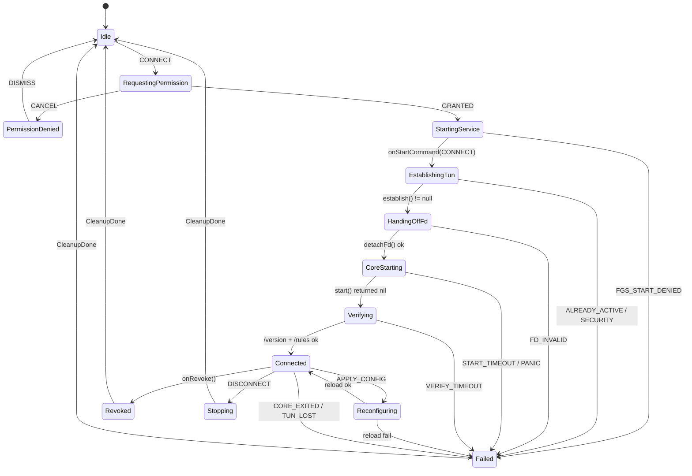

# Clash.Meta 一等公民的跨平台代理客户端 —— 架构与实现方案

> 代号临时用 `Tide`。文档版本 v1.0，面向"可以直接开写"的粒度：每个决策都有结论、有理由、有失败处理。
>
> **仓库现状**：已调整为「同一套 Flutter 代码同时编 Android 与 Windows」的形态。
> Android 专属实现（VpnService / gomobile bridge）移到了 `docs/reference/`，**不参与编译**；
> 双端入口与打包方式见 [README.md](README.md)，隔离设计见 [docs/PLATFORM_NOTES.md](docs/PLATFORM_NOTES.md)。
> 文中所有 mihomo 行为均以**锁定版本**为前提（建议 `v1.19.x` 的一个具体 tag）。带 ⚠️ 的条目是必须在开工第一周用真实内核核对一次的假设，核对清单见 [附录 A](#附录-a版本核对清单)。

---

## 0. 架构决策摘要（< 200 字）

**内核**：不改 mihomo 源码，用 gomobile 编成 AAR 跑在 Android VPN 服务进程内；控制面统一走 `127.0.0.1` 的 REST/WS（随机 secret），桌面端换 sidecar 子进程，复用同一 `CoreClient`。**隧道**：Kotlin 建 TUN、`detachFd` 交给 Go，L3 以上全归内核。**UI**：Flutter + Riverpod + go_router，自研会话流架构，共享元素 260ms 减速曲线，列表动画走 sliver 局部刷新。

理由：fd 同进程传递零成本、无 Binder 大对象；控制面与内核解耦，桌面端可无痛换运行形态；UI 只依赖 `CoreClient` 契约，内核升级不冲击页面。

---

## 1. 整体架构

### 1.1 架构图（Android 运行态）

```
┌───────────────────────────── Flutter UI Isolate ─────────────────────────────┐
│ Presentation            ProfileStream / ProfileDetail / Logs / Settings       │
│                         DesignSystem(自研) + Motion tokens                    │
├──────────────────────────────────────────────────────────────────────────────┤
│ Application             ProfileService   ActivationService   RuleTraceService │
│                         SubscriptionService   DiagnosticsService              │
├──────────────────────────────────────────────────────────────────────────────┤
│ Infrastructure          CoreApiClient(REST+WS)   ProfileStore(files)          │
│                         TraceStore(sqlite)       SecretVault(Keystore)        │
└───────────┬──────────────────────────────────────────────┬───────────────────┘
            │ MethodChannel: connect/disconnect/query      │ HTTP+WS 127.0.0.1:PORT
            │ EventChannel : AndroidVpnState / stats       │ Authorization: Bearer <secret>
┌───────────▼─────────────────── Android process ─────────▼───────────────────┐
│ TunnelService (foreground, type=specialUse/subtype=vpn)                      │
│   ├─ VpnService.Builder → ParcelFileDescriptor → detachFd()                  │
│   ├─ TunFsm (单一串行 actor，全部状态迁移只在这里发生)                        │
│   ├─ ConnectivityManager.NetworkCallback → setUnderlyingNetworks()           │
│   └─ NotificationController（1s 节流）                                        │
├──────────────────────────────────────────────────────────────────────────────┤
│ libclash.so = mihomo(Go, 未修改)                                              │
│   tun-in(fd) │ sniffer │ dns+fakeip │ rules(first-match) │ proxies/groups     │
│   REST/WS controller (127.0.0.1, 随机端口, 随机 secret)                       │
└──────────────────────────────────────────────────────────────────────────────┘
```

### 1.2 架构图（桌面端，后续阶段）

```
Flutter app ──┬── CoreApiClient ──HTTP/WS──┐
              └── ProcessSupervisor ─spawn──▶ mihomo(.exe/.app/ELF) ── TUN(需提权)
```

差异只在"谁拉起内核"和"谁建 TUN"：桌面由 `ProcessSupervisor` 拉起 sidecar 并由内核自己建 TUN（Windows 需 wintun + 管理员，macOS 需 helper 授权）；Android 由 `VpnService` 建 TUN。**`CoreClient` 接口与上层全部一致**，这是跨平台复用的关键切口。

### 1.3 分层与技术选型

| 层 | 选型 | 说明 |
|---|---|---|
| 状态管理 | Riverpod 2（code-gen） | 编译期安全、可按 selector 精确重建，动画期间不整页刷新 |
| 路由 | go_router | 深链 + `CustomTransitionPage`，支持预测式返回 |
| 模型 | freezed + json_serializable | 不可变 + copyWith，UI diff 便宜 |
| 网络 | dio（REST） + web_socket_channel（WS） | 统一拦截器注入 secret、超时、重试策略 |
| 本地库 | drift（sqlite） | 连接轨迹环形表、provider 元数据、迁移可测 |
| 文件 | path_provider + 自研 atomic writer | 配置与缓存都是文件，内核只认路径 |
| 内核 | mihomo（GPL-3.0，见 §9.4 R1）+ gomobile | 不 fork，只包一层 bridge |
| Android | Kotlin + Coroutines/Flow + DataStore | 状态机与 VpnService 全部在原生侧 |

---

## 2. 四个必答架构问题

### 2.1 进程/线程边界与内核集成形态

**结论：Android 用 gomobile AAR 进程内运行；桌面用 sidecar 子进程；控制面一律走内核自带 REST/WS，不自己发明 IPC 协议。**

| 方案 | fd 传递 | 冷启动 | 崩溃隔离 | 构建复杂度 | 结论 |
|---|---|---|---|---|---|
| A. gomobile AAR，进程内 | 直接（同进程 int fd） | 最快（~200–400ms） | 差（同生共死） | 低 | **Android v1 采用** |
| B. `:core` 独立进程 + AIDL | VpnService 也在 `:core` 进程内建，无需跨进程传 fd | 中（多一次进程启动） | 好（UI 崩溃不断隧道） | 中高 | v2 可选 |
| C. sidecar 可执行 + UDS `SCM_RIGHTS` | 需要 fd 跨进程传递 | 慢 | 好 | 高（Android 10+ W^X、SELinux） | 不推荐 Android；桌面采用 |

关键点：

- **线程边界**：Flutter 只有 UI isolate 接触状态；YAML 解析、摘要生成、diff 在 `Isolate.run` 里做。内核侧是 Go runtime 自己的 goroutine 池，与 Dart isolate 无共享内存。
- **控制面**：`PUT /configs`、`GET /connections`、`GET /rules`、`PUT /providers/rules/{name}` 都是 mihomo 官方语义，等于**免费获得一个经过社区验证的控制协议**，我们只写客户端。Dart 侧只有 5 个方法：`connect/disconnect/applyConfig/query/stream`。
- **为什么不用 gRPC / 自定义 socket**：内核不提供 gRPC；自定义协议意味着每个新功能（延迟测试、provider 更新、连接详情）都要在 Go 侧加一层包装，升级内核即返工。REST 是随内核版本免费演进的。
- **热重载触发**：`PUT /configs?force=true`，body `{"path": "<workdir 内的绝对路径>"}`，返回 204。mihomo 的 reload 是同步阻塞的，必须在 IO 线程调用，且**只覆盖 proxies / proxy-groups / rules / rule-providers / dns 等**。
- **热重载的边界（重要）**：`tun`、`mixed-port`、`external-controller` 这类监听器参数变更**不保证**就地生效（不同版本行为不同）。工程上直接定规则：**改 tun/端口 → 走隧道重建（Reconfiguring）；只改节点/组/规则/规则集 → 走热重载**。这条规则让"为什么用户改了 MTU 要断一下"变成可解释的产品行为。
- **工作目录**：内核 `-d <data>/core`，配置只能放在这个目录内，否则需要 `SAFE_PATHS` 环境变量（文档明确要求）。我们把所有 runtime 配置写在 `<data>/core/` 下，彻底绕开该限制。

### 2.2 配置生命周期：导入 → 生效

```
S0 获取 ─ S1 归一化 ─ S2 结构解析 ─ S3 静态语义校验 ─ S4 内核权威校验
   ─ S5 持久化 ─ S6 物化(runtime 补丁) ─ S7 下发内核 ─ S8 生效核验 ─ S9 预热 ─ S10 提交
```

| # | 阶段 | 关键动作 | 失败点 | 检测 | 回滚 / 降级 |
|---|---|---|---|---|---|
| S0 | 获取 | 粘贴 / SAF 文件 / 订阅 URL（UA=`clash.meta`、10MB 上限、15s 超时、3 次重定向） | 网络失败、401/403、返回 HTML 错误页、返回 base64 节点列表、zip | 状态码 + Content-Type + 首字节探测 | 保留输入框内容，行内报错 + "展开原始响应"；不落盘 |
| S1 | 归一化 | 去 BOM、CRLF→LF、Tab→空格、统一 UTF-8、丢弃非法控制字符与零宽字符（`#` 注释、块标量、锚点原样保留） | 非法 UTF-8、二进制 | 解码异常 | 拒绝导入，提示"疑似二进制/压缩包" |
| S2 | 结构解析 | YAML 1.2 解析（JSON 是子集，天然覆盖三种写法），保留 `line/column` 与原文 | 语法错误、多文档（`---`）、非 mapping | `yaml` 包异常带行列 | 定位到行，编辑器态高亮 |
| S3 | 静态语义校验 | 见 §4.2 的 40+ 条规则，产出 `ValidationIssue[]` | error 级问题 | 规则引擎 | 允许"存为草稿"但不允许激活 |
| S4 | 内核权威校验 | Go bridge `ValidateConfig`，直接调用 mihomo 的 parser | 内核拒绝（未知字段类型、非法枚举、端口冲突、证书缺失、geo 缺失） | 内核返回的 error 文本 | 与 S3 合并展示，标注"内核拒绝" |
| S5 | 持久化 | `profiles/<id>/{original.yaml, meta.json, overlay.json}`，tmp + `rename` 原子替换，保留 `lastGood/` | 磁盘满、权限、并发写 | 写入后回读 + sha256 | 保留旧目录，删除半成品 |
| S6 | 物化 | 生成 `core/runtime.yaml`：注入 controller 端口/secret、provider 路径、`profile.store-selected`、`allow-lan:false`、日志级别、设备级 prelude | 模板渲染失败、路径越界 | 渲染后再次 S3/S4 校验 | 不覆盖上一份 `runtime.yaml` |
| S7 | 下发 | `PUT /configs?force=true` | 400（配置语义错）、500、超时、内核已死 | HTTP + `GET /configs` 回读 | **先物化到 `runtime.yaml.new`，成功才 rename 覆盖**；失败则对旧 `runtime.yaml` 重新 PUT |
| S8 | 生效核验 | 对比 `GET /configs`（mode/ports）、`GET /rules`（条数+首尾指纹）、`GET /proxies`（组存在）、`GET /version` | 条数不符、组缺失、MATCH 不是最后一条 | 结构化比对 | 回滚到 `lastGood` 并重新 PUT；连续失败 2 次 → 冷重启内核 |
| S9 | 预热 | 对所有 `type: http` 的 provider 并发（3）`PUT /providers/rules/{name}`，15s 超时 | 网络失败、404、格式不符 | HTTP + `GET /providers/rules` 的 `ruleCount` | 默认**阻断激活**（安全优先，避免 RULE-SET 未加载导致流量走 MATCH 兜底）；提供"仍然启用"高级开关 |
| S10 | 提交 | 更新 active 指针、`lastActivatedAt`、`revision++`，广播状态 | — | — | — |

**核心不变量**：任何阶段失败，`active` 指针不变、内核仍在跑上一份配置、UI 展示的"当前生效配置"来自 `GET /configs`+`GET /rules` 而不是本地文件。**唯一真相在内核**，本地只是期望态。

### 2.3 "首次命中"在客户端如何体现

内核语义：连接建立时按 `rules` 数组顺序逐条匹配，**命中即停**，`MATCH` 兜底；规则集更新不改变在途连接的出口（所以改完规则要可选地踢掉旧连接，见 §5.2）。

客户端体现（三层）：

1. **规则列表**：`GET /rules` 返回有序数组，直接按 `index` 渲染序号，不重排、不排序、不折叠 `RULE-SET`。
2. **单连接命中**：`GET /connections`（WS，`?interval=2000`）每条连接自带 `rule`、`rulePayload`、`chains`、`providerChains`，这就是"命中了哪条规则 + 走了哪条链"。UI 直接展示 `rule(rulePayload) → chains[0]`。
3. **规则热度**：`GET /rules` 的 `extra.hitCount/hitAt`（⚠️ 需版本核对）可做"最近 24h 命中次数"排序，用于发现"从未命中的规则"并给出清理建议。

**需要从内核拿的字段清单**（`Connection`）：`id`、`metadata.{network,host,destinationIP,destinationPort,sourceIP,sourcePort,process,processPath,uid}`、`rule`、`rulePayload`、`chains`、`providerChains`、`start`、`upload`、`download`。

**映射规则**（UI 文案层）：`rule` 为 `RuleSet` 时 `rulePayload` 是 provider 名；`GeoIP/GeoSite` 时 payload 是国家/站点名；`Match` 时显示"兜底"。⚠️ 具体字符串以真实内核实测为准（附录 A-1）。

**成本控制**：连接流只在"日志页可见 + 应用前台"时订阅；内存环形缓冲 5000 条，落库默认关闭（隐私），用户开启后 7 天滚动删除。

### 2.4 多订阅共存与规则合并

**原则：Profile 是只读输入，Runtime 是派生产物，Merge 是一次可预览的编译。**

- **默认模式 Exclusive**：同一时刻只有一个 active profile 参与运行。简单、可预测，v1 只做这个。
- **Merge 模式**（v1.1）：`ProfileBundle{members[], priorityOrder[], mergePolicy}` → 编译出 `CompositionPlan` → 物化成单份 `runtime.yaml`。
- **规则集共享**：`rule-providers` 进入**全局内容寻址池**，key = `sha1(url|behavior|format)`。两个订阅引用同一 URL 时共用一份磁盘缓存与一次下载，**不需要**跨订阅"共享一个 provider 定义"这种耦合。

合并算法（确定性，可单测）：

1. `proxies` 指纹 = `sha1(type|server|port|uuid|password|sni|network|ws-path)`；相同指纹复用同一对象，记录 `sources[]`。
2. 名称冲突：`name` 已存在但指纹不同 → 重命名为 `name @<profile 短 id>`，并写入 `renameMap` 供 UI 展示"来自订阅 B"。
3. `proxy-groups`：默认**命名空间化**（保留原名，冲突加后缀）；策略可选 `namespace | rename | keep-first`（默认 `namespace`）。
4. `rule-providers`：同名不同 URL → 自动改名 `<name>@<hash6>`；同名同 URL → 复用。
5. `rules`：按 `priorityOrder` 拼接；**每个 profile 段尾的 `MATCH` 必须改写为该段的兜底组**，最后只保留一条全局 `MATCH → 主出口组`；拼接处插入注释标记 `# --- profile:<id> ---` 便于 diff。
6. 静态检测：组循环引用、组引用不存在的节点、同名不同义、provider 改名影响 `RULE-SET` 引用。
7. 产出 `CompositionPlan`（含 `ruleSegments[]`、`renames[]`、`warnings[]`），UI 展示"合并后有效规则顺序"再让用户确认。

风险提示（必须出现在 UI）：合并后规则顺序 = 优先级顺序，A 订阅的 `MATCH` 之前的所有规则都会先于 B 订阅生效，**跨订阅的规则顺序冲突无法自动消解**，只能由用户拖拽优先级。

---

## 3. 数据模型

完整可编译版本见 [`docs/reference/packages/clash_schema/lib/models.dart`](docs/reference/packages/clash_schema/lib/models.dart)。核心实体字段如下。

### 3.1 `ImportedProfile`

| 字段 | 类型 | 说明 |
|---|---|---|
| `id` | `String` | ULID，时间有序，便于列表排序 |
| `displayName` | `String` | 用户可改；默认取 `Content-Disposition` / `profile.name` / 订阅域名 |
| `source` | `ProfileSource` | `paste / file / url` |
| `sourceUrl` | `String?` | 订阅地址（加密存储，UI 打码） |
| `rawYaml` | `String` | **原文，永不修改**；所有编辑走 overlay |
| `contentHash` | `String` | 归一化后 sha256，用于去重与"订阅是否有更新" |
| `importedAt` | `DateTime` | |
| `lastActivatedAt` | `DateTime?` | |
| `summary` | `ConfigSummary` | 结构化摘要：节点数/组数/规则数/provider 数/规则类型直方图/是否有 dns/tun |
| `validation` | `ValidationReport` | 静态 + 内核两段结果，带耗时与内核版本 |
| `isActive` | `bool` | 同一时刻最多一个为 true（DB 唯一索引部分约束） |
| `revision` | `int` | 每次 overlay 变更 +1，用于乐观并发 |
| `subscriptionInfo` | `SubscriptionInfo?` | 解析 `subscription-userinfo` 得到流量/到期 |
| `overlay` | `ProfileOverlay` | 规则/组选择的用户改动，与原文分离 |

```dart
class ImportedProfile {
  final String id;
  final String displayName;
  final ProfileSource source;
  final String? sourceUrl;
  final String rawYaml;
  final String contentHash;
  final DateTime importedAt;
  final DateTime? lastActivatedAt;
  final ConfigSummary summary;
  final ValidationReport validation;
  final bool isActive;
  final int revision;
  final SubscriptionInfo? subscriptionInfo;
  final ProfileOverlay overlay;
}
```

### 3.2 `RuleProviderRef`

| 字段 | 类型 | 说明 |
|---|---|---|
| `name` | `String` | 与 YAML 中 key 一致，`RULE-SET` 靠它引用 |
| `type` | `RuleProviderType` | `http / file / inline` |
| `behavior` | `RuleProviderBehavior` | `domain / ipcidr / classical` |
| `format` | `RuleProviderFormat` | `yaml / text / mrs`（缺省按 `yaml`） |
| `url` / `path` | `String?` | 原始值；运行时会被物化改写为 `./providers/...` |
| `intervalSeconds` | `int?` | 原 `interval`，mihomo 有最小值钳制，UI 展示前先归一 |
| `proxy` | `String?` | 下载走哪个出口 |
| `cachePath` | `String?` | 客户端本地缓存绝对路径（内容寻址） |
| `cacheState` | `ProviderCacheState` | `absent / fresh / stale / error` |
| `lastUpdatedAt` | `DateTime?` | 取 `GET /providers/rules` 的 `updatedAt` |
| `ruleCount` | `int?` | 同上，用于"当前生效规则总数" |
| `lastError` | `String?` | 最近一次更新失败原因 |

```dart
class RuleProviderRef {
  final String name;
  final RuleProviderType type;
  final RuleProviderBehavior behavior;
  final RuleProviderFormat format;
  final String? url;
  final String? path;
  final int? intervalSeconds;
  final String? proxy;
  final String? cachePath;
  final ProviderCacheState cacheState;
  final DateTime? lastUpdatedAt;
  final int? ruleCount;
  final String? lastError;
}
```

### 3.3 `ProxyGroupSnapshot`

| 字段 | 类型 | 说明 |
|---|---|---|
| `name` | `String` | |
| `kind` | `ProxyGroupKind` | `select / urlTest / fallback / loadBalance / relay / unknown` |
| `now` | `String?` | 当前出口；`loadBalance` 无此字段（UI 显示"自动"） |
| `all` | `List<String>` | 成员（可能是组名，递归展示时注意深度上限 5） |
| `fixed` | `String?` | 手动钉住的节点（url-test/fallback） |
| `testUrl` | `String?` | 测速 URL |
| `expectedStatus` | `String?` | |
| `hidden` / `iconUrl` | `bool` / `String?` | 只影响 UI |
| `latency` | `Map<String,int?>` | 本地维护的最近测速结果，非内核字段 |
| `capturedAt` | `DateTime` | 快照时间，UI 显示"3 秒前" |

### 3.4 `RuleTrace`

| 字段 | 类型 | 说明 |
|---|---|---|
| `connectionId` | `String` | 内核 connection id |
| `host` / `destIp` / `destPort` | `String?` / `String?` / `int?` | 来自 `metadata` |
| `network` | `String` | `tcp / udp` |
| `processName` / `uid` | `String?` / `int?` | Android 上依赖内核进程匹配能力，可能为空 |
| `matchedRuleText` | `String` | 渲染用规则文本，**不含出口**：`RULE-SET,cn-domain` / `DOMAIN-SUFFIX,google.com` |
| `ruleType` / `rulePayload` | `String` | 内核原值 |
| `providerName` | `String?` | `ruleType == RuleSet` 时由 payload 反查 |
| `outboundName` | `String` | 实际拨号节点（`chains.first`）。⚠️ 只用于展示，不做路由语义判断 |
| `chain` | `List<String>` | 完整链路，内层→外层；顺序以实测为准（附录 A-1） |
| `upload` / `download` | `int` | 字节 |
| `startedAt` / `closedAt` | `DateTime` / `DateTime?` | |
| `verdict` | `TraceVerdict` | `proxied / direct / rejected / unknown` |

### 3.5 `AndroidVpnState`

| 字段 | 类型 | 说明 |
|---|---|---|
| `phase` | `TunnelPhase` | 见 §6.1 枚举 |
| `prepare` | `PrepareState` | `notRequested / granted / denied / unsupported` |
| `service` | `ServiceState` | `stopped / starting / running / foreground` |
| `tunFd` | `TunFdState` | `none / established / handedOff / invalid` |
| `core` | `CoreState` | `stopped / starting / running / unreachable` |
| `error` | `TunnelError?` | `code / message / recoverable / cause` |
| `sessionId` | `String?` | 每次连接生成，防止旧事件污染新状态 |
| `since` | `DateTime` | 进入当前 phase 的时间 |
| `underlying` | `String?` | `wifi / cellular / ethernet / vpn / none` |
| `coreVersion` | `String?` | `GET /version` |

```dart
enum TunnelPhase {
  idle, requestingPermission, startingService, establishingTun,
  handingOffFd, coreStarting, verifying, connected,
  reconfiguring, stopping, revoked, failed,
}
```

---

## 4. Clash.Meta 导入链路专项

### 4.1 解析：三种写法要不要都支持？

**要，但不需要写三个解析器。** YAML 1.2 是 JSON 的超集，多行 YAML、多行 JSON、单行 JSON 在同一个 parser 下都能得到同一个 `Map`：

| 写法 | 示例 | 处理方式 |
|---|---|---|
| 多行 YAML | `proxies:\n  - name: a\n    type: ss` | 标准块状 |
| 多行 JSON（花括号跨行） | `{\n "proxies": [ … ]\n}` | flow mapping，YAML 直接吃 |
| 单行 JSON | `{"proxies":[{"name":"a","type":"ss"}],"rules":["MATCH,DIRECT"]}` | 同上，归一到同一 AST |

工程实现要点：

1. **一次解析、双份产物**：`yaml` 包解析出 `Map` 用于校验/摘要；原文逐字节保留用于 diff 与"用户到底粘了什么"的取证。不要用解析结果回写原文。
2. **`yaml_edit` 做外科手术**：用户改单条规则时用 `yaml_edit` 只改动对应节点，保留注释、缩进、锚点；整体物化（runtime.yaml）才允许全量重新 emit，并在文件头写 `# generated by Tide, do not edit`。
3. **不要用正则修补 YAML**。缩进、块标量（`private-key: |`）、行内注释都会让正则注入产生"写进去了但不生效"的幽灵 bug；必须走 AST。
4. **方言差异**：Go 的 `yaml.v3` 与 Dart 的 `yaml` 在 YAML 1.1 布尔（`on/off/yes/no`）、八进制、日期、重复 key 上处理不同。**结论：Dart 解析只用于摘要与 lint，最终裁决永远交给内核 parser**（S4）。重复 key 一律报 error（`E_DUP_KEY`），因为不同实现取第一个还是最后一个并不一致。
5. **明确拒绝的输入**（给出可行动提示，而不是"解析失败"）：
   - `---` 多文档 → `E_MULTI_DOC`："Clash.Meta 只接受单文档，请删除 `---` 之后的内容"
   - base64 节点列表（v2ray 订阅）→ `E_NOT_CLASH`："这是节点列表，不是 Clash.Meta 配置"
   - zip / 二进制 → `E_BINARY`
   - HTML 错误页 → `E_HTML_RESPONSE`，附前 200 字符
6. **性能**：1 MB YAML 在 UI isolate 解析约 80–150ms，会掉帧。一律 `Isolate.run`，并设置 5MB 硬上限（超过直接拒绝，提示"疑似把整个规则库粘进来了"）。

### 4.2 导入时必须校验什么

分两级：**静态 lint（快、带行列、可解释）** + **内核校验（权威、不可绕过）**。静态 lint 的价值不是替代内核，而是把"内核只会说 `yaml: unmarshal errors: line 42`"翻译成"第 42 行的策略组 `Auto` 引用了不存在的节点 `HK-01`"。

**顶层**

| 检查 | 级别 | 码 |
|---|---|---|
| 根节点是 mapping | error | `E_TOP_NOT_MAP` |
| 至少存在 `proxies` 或 `proxy-providers` | error | `E_NO_PROXY_SOURCE` |
| `rules` 存在且非空 | error | `E_NO_RULES` |
| `mode ∈ {rule, global, direct}` | error | `E_MODE_INVALID` |
| `port/socks-port/mixed-port ∈ [0,65535]` | error | `E_PORT_RANGE` |
| 未知顶层键 | warning | `W_UNKNOWN_TOP_KEY` |

**proxies**

| 检查 | 级别 | 码 |
|---|---|---|
| 每项含 `name`、`type` | error | `E_PROXY_MISSING_FIELD` |
| `name` 全局唯一 | error | `E_PROXY_DUP_NAME` |
| `type` 在内核支持枚举内（从锁定版本导出白名单，不手写） | error | `E_PROXY_TYPE_UNKNOWN` |
| `server`/`port` 必填（`DIRECT` 等除外） | error | `E_PROXY_ENDPOINT` |
| 凭据字段（`password`/`uuid`/`auth`）缺失 | error | `E_PROXY_CRED_MISSING` |
| 未知字段（`skip-cert-verify` 拼错高发） | warning | `W_PROXY_UNKNOWN_FIELD` |

**proxy-groups**

| 检查 | 级别 | 码 |
|---|---|---|
| `name` 唯一，且不与 proxy 重名 | error | `E_GROUP_NAME_CONFLICT` |
| `type ∈ {select,url-test,fallback,load-balance,relay}` | error | `E_GROUP_TYPE_UNKNOWN` |
| `proxies` 非空 | error | `E_GROUP_EMPTY` |
| 每个成员 ∈ `proxies ∪ proxy-groups ∪ {DIRECT,REJECT,REJECT-DROP,PASS,COMPATIBLE,GLOBAL}` | error | `E_GROUP_REF_MISSING` |
| 组间循环引用（含自引用） | error | `E_GROUP_CYCLE` |
| `url-test`/`fallback` 缺 `url` | warning | `W_GROUP_NO_URL` |
| `interval < 60` | warning | `W_GROUP_INTERVAL` |

**rules**（本项目最高优先级）

| 检查 | 级别 | 码 |
|---|---|---|
| 每条至少 2 段（`TYPE,PAYLOAD,TARGET` 或 `TYPE,TARGET`） | error | `E_RULE_ARITY` |
| `type` 合法（含 `AND/OR/NOT/SUB-RULE/RULE-SET/GEOSITE/GEOIP/PROCESS-*/UID/IN-*/NETWORK/DSCP/SRC-*/DST-PORT/IP-ASN/IP-SUFFIX`，以锁定版本枚举为准） | error | `E_RULE_TYPE_UNKNOWN` |
| **`MATCH` 恰好一条且位于最后一行** | error | `E_MATCH_MISSING` / `E_MATCH_NOT_LAST` / `E_MATCH_DUPLICATE` |
| `MATCH` 不携带额外参数（`MATCH,DIRECT` 合法；`MATCH,X,DIRECT` 非法） | error | `E_MATCH_ARITY` |
| TARGET 存在（proxy / group / 内置策略） | error | `E_RULE_TARGET_MISSING` |
| `RULE-SET` 的 payload 在 `rule-providers` 中存在 | error | `E_RULE_PROVIDER_MISSING` |
| `GEOSITE`/`GEOIP` payload 非空 | error | `E_GEO_PAYLOAD` |
| CIDR 语法合法 | error | `E_CIDR_INVALID` |
| 逻辑规则括号配对、嵌套 ≤ 8 | error | `E_LOGIC_SYNTAX` / `E_LOGIC_DEPTH` |
| `no-resolve` 用在非 IP 类规则上 | warning | `W_NO_RESOLVE_IGNORED` |
| 完全重复（type+payload+target） | warning | `W_RULE_DUPLICATE` |
| 定义但从未被引用的 provider | warning | `W_PROVIDER_UNUSED` |
| 规则数 > 20000 | warning | `W_RULE_TOO_MANY`（移动端内存与首连延迟风险） |

**rule-providers**

| 检查 | 级别 | 码 |
|---|---|---|
| `name` 唯一 | error | `E_PROVIDER_DUP_NAME` |
| `type ∈ {http,file,inline}` | error | `E_PROVIDER_TYPE` |
| `behavior ∈ {domain,ipcidr,classical}` | error | `E_PROVIDER_BEHAVIOR` |
| `format ∈ {yaml,text,mrs}` | error | `E_PROVIDER_FORMAT` |
| `type: http` 必须有 `url`；`type: file` 必须有 `path` 且文件存在 | error | `E_PROVIDER_SOURCE` |
| **behavior × format 兼容**：`domain`/`ipcidr` 支持 `yaml/text/mrs`；`classical` 仅 `yaml` | error | `E_PROVIDER_FORMAT_INCOMPAT` |
| `interval` 为负 | error | `E_PROVIDER_INTERVAL` |
| 配置里出现 `file-descriptor` | error | `E_RESERVED_FIELD`（fd 只能由客户端注入） |

> ⚠️ `classical` + `mrs` 是否被支持需实测（A-3）。默认按"不支持"处理，遇到就降级为 `yaml` 并提示。

**dns / tun**

| 检查 | 级别 | 码 |
|---|---|---|
| `dns.enable: true` 时必须存在 `nameserver` 或 `nameserver-policy` | error | `E_DNS_NO_SERVER` |
| nameserver 条目协议/格式合法（`udp://`、`tls://`、`https://`、`#h3=true` 等） | error | `E_DNS_SERVER_FORMAT` |
| `enhanced-mode: fake-ip` 但无 `fake-ip-range` | warning | `W_FAKEIP_RANGE` |
| `tun.stack ∈ {system,gvisor,mixed,mips}` | error | `E_TUN_STACK` |
| `tun.mtu ∉ [1280,9000]` | warning | `W_TUN_MTU` |
| 移动端出现 `tun.auto-route/auto-redirect` | warning | `W_TUN_CLIENT_MANAGED`（物化时强行改写，UI 说明"路由由 App 接管"） |

落地形态：`ValidationReport { issues[], staticMs, kernelOk, kernelMs, kernelVersion }`；UI 里 error 阻断激活、warning 折叠展示、每条 issue 可点击跳到规则原文行。

### 4.3 远程 rule-providers：预拉取还是交给内核？

| 方案 | 优点 | 缺点 |
|---|---|---|
| **A. 只记录 URL，内核运行时拉取** | 单一缓存 owner；周期更新免费；实现最少；与内核行为完全一致 | 激活前不知道可用性；UI 无法显示条目数；错误发生得晚；离线不可用 |
| **B. 客户端预拉取、校验后交内核** | 早失败；可展示条目数与格式；可离线；可做内容审计 | 双份缓存/双倍流量；要自己写更新调度；与内核缓存的版本可能不一致 |

**采用 A + 轻探测 + 预热（不落第二份缓存）**：

1. 导入时：对 `http` provider 发 `HEAD`（失败退化为 `GET Range: bytes=0-1023`），只验证"可达 + 首字节像 YAML/纯文本/MRS 魔数"，**不下载全量**。存 `reachable/lastError`。
2. 激活时：物化后、提交前，对全部 `http` provider 并发 3 个 `PUT /providers/rules/{name}` 预热，15s 超时。失败默认阻断（理由：RULE-SET 未加载 = 该规则恒不命中 → 流量悄悄走 MATCH 兜底，用户完全无感，是最危险的静默错误）。
3. 运行期：更新由内核 `interval` 负责；客户端只在设置页提供"立即更新"，以及前台每 5 分钟做一次"到期检查"（只对 due 的 provider 发 PUT）。
4. **离线包**（v1.1）：用户显式勾选"离线可用"时，才完整下载 → 校验 → 改 `type: file` + 本地路径，进入方案 B。这是一个功能，不是默认路径。

---

## 5. 规则运行时

### 5.1 规则集本地化：要不要按 behavior 分目录？

**要。** 三个 behavior 的文件内容形状、体积、更新频率、解析成本完全不同，混在一起会让"哪个文件坏了"不可诊断。

工作目录（`<appSupport>/core/`，即 mihomo `-d`）：

```
core/
├── runtime.yaml                 # 物化产物，唯一交给内核的配置
├── cache.db                     # 内核自己的 cache（store-selected 等）
├── providers/
│   ├── domain/3f9c…a1.yaml      # 内容寻址：sha1(url|behavior|format)
│   ├── ipcidr/9b02…c7.mrs
│   └── classical/1d77…e0.yaml
├── geo/                         # GeoIP.dat / GeoSite.dat / country.mmdb（离线内置一份）
└── logs/
```

| behavior | 典型来源 | 建议 format | 更新策略 | 失败影响 |
|---|---|---|---|---|
| `domain` | 域名清单（几千~几十万行） | `mrs` > `yaml` | 24h | 域名分流失效 → 走兜底 |
| `ipcidr` | IP 段（万级） | `mrs` | 24h | IP 分流失效，可能直连泄漏 |
| `classical` | 混合规则（含 target） | `yaml` | 24h | 整段规则失效 |

- 物化时把 `rule-providers.*.path` 改写成 `./providers/<behavior>/<hash>.<ext>`（相对 `-d`），并保留 `originalPath` 映射给 UI；内核只看到受控路径。
- 文件名内容寻址的收益：多个 profile 引用同一 URL 时天然共享一份文件；GC 规则 = "连续 7 天不被任何 profile 引用即删"。
- Geo 文件必须**内置离线包**：没有有效 geo 文件时 mihomo 会直接退出（这是移动端首次启动、无网场景的硬故障）。内置一份精简版，启动时比对版本，必要时后台更新。

### 5.2 不重启内核让新规则生效

```http
PUT /providers/rules/{name}
Authorization: Bearer <secret>
→ 204 No Content
```

- 内核原地替换该 provider 的数据；`RULE-SET` 规则持有 provider 引用，因此**下一次连接匹配时即生效**（⚠️ A-2 用真实内核验证）。
- **在途连接不会重路由**（规则在连接建立时求值一次）。要让新规则对现有连接生效，标准做法是精准踢连接，而不是断全部：

```http
GET  /connections                     # 取 id + rule + rulePayload + chains
DELETE /connections/{id}              # 只踢命中该 provider 的连接
```

- 失败语义：`404` provider 不存在、`400` 格式不符、超时（15s）。内核不会因为更新失败清空旧数据，所以策略是**保留旧数据 + UI 标记 stale**，不要删除本地文件。
- UI 要展示（三条都必要，缺一条就会被问"到底生效了没"）：
  1. **当前生效规则总数**：分两个数——顶层规则条数 `GET /rules`.length、provider 展开条目数 `Σ ruleCount`。只显示一个数一定被误解。
  2. **每个 provider 的最后更新时间 / 条目数 / behavior / format / 失败原因**：`GET /providers/rules`。
  3. **某条规则来自哪个 provider**：规则列表里 `RULE-SET` 行的 payload 即 provider 名；单条连接用 `RuleTrace.providerName`。

### 5.3 规则与策略组可视化、以及"能不能编辑"

| UI 视图 | 数据源 | 刷新 |
|---|---|---|
| 策略组列表 | `GET /proxies` 过滤 `Selector/URLTest/Fallback/LoadBalance/Relay` | 5s 或手动 |
| 组当前选中 | 上述对象的 `now`（`LoadBalance` 无 `now`） | 同上 |
| 节点延迟 | `GET /proxies/{n}/delay?url=…`、`GET /group/{g}/delay` | 手动/进入页面 |
| 规则列表 | `GET /rules`（`index/type/payload/proxy/extra.hitCount`） | 10s |
| 规则集 | `GET /providers/rules` | 10s |
| 连接命中 | `GET /connections`（WS 2s） | 页面可见时 |

**编辑能力分三档，不要一步到位：**

| 档位 | 能力 | 机制 | 风险 |
|---|---|---|---|
| v1 | 只读 + 临时禁用单条规则 | `PATCH /rules/disable {"12": true}` | 重启即失效，UI 必须标"临时" |
| v1.1 | overlay 持久编辑：增 / 删 / 移动 / 改 TARGET | `overlay.json` + 重新物化 | 需要 diff 预览与乐观锁 |
| v2 | 可视化规则构建器 / 订阅级模板 | 同上 + 模板 DSL | 复杂度高，先不做 |

overlay 数据模型（**永不修改原文**）：

```json
{
  "revision": 7,
  "ruleOps": [
    {"op": "move",   "from": 12, "to": 3},
    {"op": "delete", "index": 20, "expectHash": "sha256:..."},
    {"op": "insert", "at": 5, "value": "DOMAIN-SUFFIX,example.com,PROXY"},
    {"op": "setTarget", "index": 8, "value": "DIRECT"}
  ],
  "groupPins": {"Auto": "HK-01"}
}
```

- 应用顺序固定：`delete` → `move` → `setTarget` → `insert`，保证可重放。
- `delete`/`move` 带 `expectHash`（该行内容哈希）：订阅更新后行号漂移时能检测到冲突，降级为"按内容匹配"并要求用户确认，而不是静默改错位置。
- 下发流程复用 S3→S7：校验 → **diff 预览（新增绿/删除红/移动带箭头）** → 应用 → 失败自动回滚。每次应用生成新的 `runtime.yaml` 并记录 `revision`。
- 组选择用内核能力持久化：`profile.store-selected: true`，同时在 overlay 记一份，换设备/重装后能恢复。

---

## 6. Android 端到端适配

### 6.1 隧道状态机



> 失败/被收回都不直接回 Idle，而是先走统一清理（停内核 → 关 fd → 撤通知 → stopSelf），
> 清理完成后再回 Idle；`error` 字段保留，UI 在 Idle 态仍能展示"上次失败原因"。

| 迁移 | 触发 | 守卫条件 | 动作 | 失败码 |
|---|---|---|---|---|
| Idle→RequestingPermission | 用户点连接 | 未授权 | `VpnService.prepare()`，非 null 则 `startActivityForResult` | `E_VPN_PERMISSION_DENIED` |
| →StartingService | 已授权 / 返回 OK | 应用在前台 | `startForegroundService(ACTION_CONNECT)` | `E_FGS_START_DENIED`（Android 12+ 后台启动限制） |
| →EstablishingTun | service `onStartCommand` | 5s 内 `startForeground` | 构建 Builder → `establish()` | `E_VPN_ALREADY_ACTIVE`、`E_TUN_ESTABLISH_FAILED` |
| →HandingOffFd | 拿到 PFD | ABI 已加载 | `detachFd()` → `CoreBridge.start(home, cfg, fd)` | `E_TUN_FD_INVALID` |
| →CoreStarting | Go 返回 | 8s 超时 | 等待 `GET /version` 可通 | `E_CORE_START_TIMEOUT` |
| →Verifying | 端口可连 | 5s 超时 | 校验 `/configs` mode、`/rules` 首尾、`/proxies` 组 | `E_VERIFY_FAILED` |
| →Connected | 校验通过 | — | 广播 state、起通知刷新、`setUnderlyingNetworks` | — |
| →Reconfiguring | 应用新配置 | 内核存活 | `PUT /configs` → 复核 | `E_RELOAD_FAILED` |
| →Revoked | 系统回调 `onRevoke` | — | 关核心、停前台、清 fd、`desired=false`、30s 内禁止自动重连 | — |
| →Failed | 任一步 | — | 反向清理 + 通知"已断开（原因）"，清理完成后回 Idle，`error` 保留 | 见上 |

实现约束：

- **所有迁移在单一 `Channel<Event>` 上串行执行**（`Dispatchers.Main.immediate` + actor），禁止从 `NetworkCallback`、通知 action、MethodChannel 三处并发改状态。
- **每次连接生成 `sessionId`**，Go 侧回调与网络回调都带 sessionId，旧 session 的事件直接丢弃（防止"断开后 2s 收到上一次的 ready"）。
- `establish()` 必须 try/catch：另一个 VPN 正在运行会抛 `IllegalStateException`；权限被撤销抛 `SecurityException`。
- `detachFd()` 之后**绝对不能**再 `close()` 那个 `ParcelFileDescriptor`，否则 fd 编号被回收后再被复用，会出现"连上了但所有流量黑洞"的诡异 bug。

### 6.2 前台服务与通知

```xml
<uses-permission android:name="android.permission.INTERNET" />
<uses-permission android:name="android.permission.ACCESS_NETWORK_STATE" />
<uses-permission android:name="android.permission.FOREGROUND_SERVICE" />
<uses-permission android:name="android.permission.FOREGROUND_SERVICE_SPECIAL_USE" />
<uses-permission android:name="android.permission.POST_NOTIFICATIONS" />

<application android:enableOnBackInvokedCallback="true">
  <service
      android:name=".tunnel.TunnelService"
      android:exported="false"
      android:permission="android.permission.BIND_VPN_SERVICE"
      android:foregroundServiceType="specialUse">
    <intent-filter>
      <action android:name="android.net.VpnService" />
    </intent-filter>
    <property
        android:name="android.app.PROPERTY_SPECIAL_USE_FGS_SUBTYPE"
        android:value="vpn" />
  </service>
</application>
```

- Android 14（targetSdk 34）起，前台服务必须声明类型；VPN 没有专属类型，业界通行做法是 `specialUse` + subtype 属性 `vpn`（FlClash 等同类产品同样如此）。
- `POST_NOTIFICATIONS`（33+）是运行时权限：**拒绝了也必须 `startForeground()`**，服务照常运行，通知只出现在系统"任务管理器"里。此时 App 内要显示"通知被关闭，无法在通知栏断开"的提示条。
- 通知渠道：`IMPORTANCE_LOW` + `setSound(null)` + 无震动 + 不显示角标；`setOngoing(true)`、`setOnlyAlertOnce(true)`、`setShowWhen(false)`、`setForegroundServiceBehavior(FOREGROUND_SERVICE_IMMEDIATE)`。
- 通知内容（最小必要）：`title = 已连接 · 规则模式`，`text = ↓ 1.2 MB/s ↑ 96 KB/s · 12 连接`，`subText = 配置名`，一个 action「断开」。刷新 ≤1Hz，且只在文本变化时 `notify`；息屏时降到 1/3Hz。
- 断开必须走 `PendingIntent` → service 的 `ACTION_DISCONNECT`（不要在通知里直接 `stopService`，否则来不及关 fd 和停内核）。
- `stopForeground(STOP_FOREGROUND_REMOVE)` + `stopSelf()` 的顺序：先停核心 → 关 fd → 移通知 → `stopSelf`。

### 6.3 后台保活：合规边界

| 手段 | 合规 | 收益 | 说明 |
|---|---|---|---|
| 前台服务 `specialUse` | ✅ 必须 | 高 | 这是唯一"正统"手段 |
| `START_STICKY` + `onStartCommand` 重建 | ✅ | 高 | 进程被杀后系统会尝试重启；重建时按 `desiredState` 恢复 |
| `onTaskRemoved` 延迟重启 | ⚠️ 谨慎 | 中 | 用户从最近任务划掉 = 明确意图，不要立刻复活；最多在 `desiredState=connected` 时保留服务 |
| `ConnectivityManager` 默认网络回调 + `setUnderlyingNetworks` | ✅ 必须 | 高 | 切 WiFi/蜂窝必须重新绑定，否则隧道假死 |
| Always-on VPN（系统级） | ✅ 推荐 | 极高 | 用户开启后由系统在开机/网络变化时拉起，是唯一可靠的"开机自连" |
| 引导用户关闭电池优化（跳设置页） | ✅ 推荐 | 中 | **只跳转，不申请** `REQUEST_IGNORE_BATTERY_OPTIMIZATIONS`（Play 政策限制，VPN 也不构成豁免理由） |
| 短时 `PARTIAL_WAKE_LOCK`（≤10s，仅重建期） | ✅ | 低 | 仅用于网络切换后的重建窗口 |
| `WorkManager` 周期任务（≥15min） | ✅ | 低 | 只做 provider 到期检查，不做保活 |
| 1px Activity / 静音音频 / 空通知循环 | ❌ | — | 违反 Play 政策，且在国产 ROM 上照样被杀 |
| 监听 `BOOT_COMPLETED` 拉起前台服务 | ❌ 无效 | — | Android 12+ 禁止从后台启动 FGS；开机自连只能靠 Always-on |

**进程被杀后的恢复**：`DataStore` 持久化 `desiredState(connected|disconnected)` + `lastProfileId` + `lastError`。服务重建时：

1. `desiredState != connected` → 直接 `stopSelf`。
2. `VpnService.prepare() == null`（仍授权）→ 重新建 TUN、重启内核、校验。**不重放 prepare 弹窗**。
3. `prepare() != null`（授权被撤）→ 清 `desiredState`，发一条"VPN 权限已被撤销"通知，不启动。

### 6.4 VpnService 配置细节

```kotlin
val builder = Builder()
  .setSession("Tide")
  .setMtu(1500)
  .addAddress("172.19.0.1", 30)          // 同网段 .2 作为 DNS 目标
  .addRoute("0.0.0.0", 0)
  .setBlocking(false)                    // 严格模式才 true，见下
  .setMetered(false)
  .setConfigureIntent(pendingIntent)     // 点通知进 App
  .addDisallowedApplication(packageName) // 自己不进隧道，避免回环
if (ipv6Enabled) {
  builder.addAddress("fdfe:dcba:9876::1", 126).addRoute("::", 0)
}
builder.setDnsServer("172.19.0.2")       // 交给内核 dns-hijack 接管
if (ipv6Enabled) builder.setDnsServer("fdfe:dcba:9876::2")
// 分应用：白名单用 addAllowedApplication，黑名单用 addDisallowedApplication
// 绕过局域网：API 33+ 用 excludeRoute，低版本用规则 prelude（见下表）
```

| 关注点 | 由谁负责 | 结论 |
|---|---|---|
| 地址、路由、MTU、DNS 服务器、允许/排除应用、底层网络 | **Kotlin / VpnService.Builder** | 这是 Android 的接口契约，内核碰不到 |
| sniffing、fake-ip、规则匹配、DNS 解析策略、出站、流量统计 | **mihomo** | L3 以上全部归内核，客户端不重复实现 |
| 绕过私有网络 | Kotlin（`excludeRoute`，API 33+）；旧版本注入规则 prelude | 见下 |
| DNS 劫持 | 内核 `dns-hijack: ["any:53"]` + Builder 指向 tun 内地址 | 不要自己写 DNS 代理 |
| 分应用 | Kotlin | 白名单/黑名单二选一，UI 明确"未选中的应用完全绕过 VPN"（这是泄漏点） |

细节决策：

- **`setBlocking`**：默认 `false`。`true`（严格模式）能防内核崩溃时的流量明文泄漏，但内核挂掉 = 全设备断网，且不能在运行中切换，只能重建。提供开关，文案写清代价。
- **IPv6**：配置 `ipv6: false` 时不加 v6 地址与路由。注意纯 v6 网络（464XLAT）下会不可用，连接前检测 `NetworkCapabilities` 给出警告。
- **绕过局域网**：API 33+ 用 `Builder.excludeRoute(IpPrefix)` 排除 `10/8`、`172.16/12`、`192.168/16`、`fc00::/7`、`fe80::/10`。API < 33 无等价能力，只能注入"设备级 prelude"规则（`IP-CIDR,192.168.0.0/16,DIRECT,no-resolve` 等），并在 UI 标注"这些规则由 App 注入，不属于你的订阅"。prelude 在物化时插入且带注释标记，绝不写回 `original.yaml`。
- **DNS 与 Private DNS 冲突**：系统开启"私人 DNS"（DoT）时，DNS 查询不经 53 端口，内核无法劫持 —— 这会造成"域名规则失效但 IP 规则仍生效"的诡异现象。连接前检测 `PrivateDns` 状态并提示，不要静默。
- **Always-on VPN**：用户开启后系统以 `intent == null` 启动服务，**不需要也不会弹授权**。此时：立刻 `startForeground`、读 `desiredState`（未设置则用最近一次配置）、失败要发通知而不是静默 `stopSelf`（否则系统可能反复重启形成循环）。Always-on + 严格模式组合下，内核起不来等于断网，必须给出明确通知。
- **MTU**：Builder 与 `tun.mtu` 保持一致（1500）。蜂窝网络下如出现大包卡死，提供 1400 预设；不要自动改（会导致 TunFd 重建）。

### 6.5 内核与 VpnService 的衔接（推荐方案 + 理由）

**推荐：gomobile AAR 进程内运行，fd 直接以 `int` 传入 Go。**

```kotlin
val pfd = builder.establish() ?: throw TunnelError.EstablishFailed
val fd = pfd.detachFd()                       // 交出所有权，之后不得 close
try {
    CoreBridge.start(workDir = coreDir, configPath = runtimeYaml, tunFd = fd)
} catch (t: Throwable) {
    ParcelFileDescriptor.adoptFd(fd).close()  // 失败才回收
    throw TunnelError.CoreStartFailed(t)
}
```

```go
// native/corebridge/bridge.go（节选）
func Start(home, configPath string, tunFd int) error {
    cfg, err := config.Parse(configPath)      // 与 CLI 同一条解析路径
    if err != nil { return err }
    applyTunFD(cfg, tunFd)                    // 注入 fd（见 tunfd_android.go）
    return executor.Start(cfg, true)
}
```

理由（按权重）：

1. **fd 传递零成本**：同进程就是一个整数，没有 `SCM_RIGHTS`、没有 Binder `ParcelFileDescriptor` 跨进程、没有 SELinux 例外。
2. **启动快**：冷启动到可校验 ~300ms，状态机不需要等进程 fork/exec。
3. **构建简单**：一个 AAR，一个 `System.loadLibrary`，无二进制分发/可执行权限/文件锁问题。
4. **调试链路短**：Go panic 的栈能直接进 logcat（要装 panic handler）。

它唯一的硬伤是**崩溃共死**。缓解：Go 侧 `defer recover()` 把 panic 转成 error 返回、Kotlin 侧不捕获 `Error` 但保证清理、服务 `START_STICKY` 重建、以及把"内核异常退出"作为一等错误码上报。

**备选：`:core` 独立进程 + AIDL**，当且仅当出现以下需求时才升级：UI 进程频繁 OOM 需与隧道隔离、要支持"关掉 App 隧道仍在"、或要同进程跑多引擎。届时 **`VpnService` 也声明在 `:core` 进程**（`android:process=":core"`），fd 依然同进程，只有控制面走 AIDL/Binder（Binder 天然带 UID 校验，鉴权问题一并解决）。

**本地 API 鉴权（关键）**：Android 的 loopback 不是按应用隔离的，任何应用都能连 `127.0.0.1`。所以：

- 每次启动生成 32 字节随机 `secret`，写进 `runtime.yaml`（`secret: <base64url>`），随隧道停止作废；
- `external-controller: 127.0.0.1:<随机 20000–60000 端口>`，`allow-lan: false`，`external-ui` 留空（不暴露面板）；
- Dart 侧从 MethodChannel 拿到 `{port, secret}`，之后所有请求带 `Authorization: Bearer`；
- secret 不写日志、不进崩溃报告、`runtime.yaml` 权限 0600 且排除出自动备份；内存中只保留当前值，另存一份到 `EncryptedSharedPreferences`（Keystore 加密）——因为 Always-on VPN 在进程被杀后会由系统直接拉起服务（`intent == null`），此时 Flutter 引擎还没起来，没有人能重新生成 secret。每次用户主动连接都轮换；
- 桌面端沿用同一机制；若威胁模型要求更高，v2 改 `external-controller-unix` + 原生代理（Dart 没有 UDS 客户端，需要 Kotlin/Swift 侧转一层）。

### 6.6 权限与兼容性清单

| 权限 / 声明 | API | 类型 | 用途 | 缺失时 |
|---|---|---|---|---|
| `INTERNET` | 1 | normal | 控制面 + 订阅 | 不可能缺失 |
| `ACCESS_NETWORK_STATE` | 1 | normal | 网络回调、`setUnderlyingNetworks` | 隧道切网假死 |
| `FOREGROUND_SERVICE` | 28 | normal | 前台服务 | 无法长时间运行 |
| `FOREGROUND_SERVICE_SPECIAL_USE` | 34 | normal | Android 14 类型要求 | 服务被系统立即杀死 |
| `POST_NOTIFICATIONS` | 33 | runtime | 通知栏 | 可运行但无通知，需应用内提示 |
| `BIND_VPN_SERVICE`（service 级） | 14 | signature | 只允许系统绑定 | 无法成为 VPN |
| `QUERY_ALL_PACKAGES` | 30 | normal（Play 需声明） | 分应用列表 | 只能列出可解析 launcher 的应用，列表不全 |
| `RECEIVE_BOOT_COMPLETED` | 1 | normal | 仅用于"开机向导"提示 | 不影响 Always-on |
| `ACCESS_WIFI_STATE` | 1 | normal | 展示 WiFi 名称（可选） | 仅少一个信息 |

明确**不申请**：`REQUEST_IGNORE_BATTERY_OPTIMIZATIONS`（Play 限制，改跳设置页）、`SYSTEM_ALERT_WINDOW`、`WRITE_SETTINGS`。

厂商兼容风险与降级：

| 风险 | 表现 | 处理 |
|---|---|---|
| MIUI / HyperOS 把 `FOREGROUND_SERVICE_SPECIAL_USE` appop 置为 ignore | Android 14+ 上服务秒死、`tun0` 不出现 | 启动后 3s 校验 `tun` 是否仍存在；失败引导"设置 → 应用 → 权限 → 后台弹出界面/自启动"；检测到 HyperOS 时在引导页置顶提示 |
| EMUI / HarmonyOS 电池管理 | 息屏 10 分钟后断 | 引导加入"受保护应用"；失败重连 + 通知 |
| ColorOS / OriginOS / Flyme 深度睡眠 | 同上 | 引导关闭"智能省电" |
| Samsung "休眠应用" | 长期不用被冻结 | 引导加入"从不休眠"列表 |
| Private DNS | DNS 劫持失效，域名规则不生效 | 连接前检测并提示 |
| 同时只允许一个 VPN | `establish()` 抛异常 | `E_VPN_ALREADY_ACTIVE`，提示关闭其它 VPN |
| 工作资料（Work Profile） | 无法覆盖工作资料流量 | 文档说明，不承诺 |
| 纯 IPv6 / 464XLAT | 未加 v6 路由时不可用 | 检测并警告 |
| 16KB page size（Android 15+ 设备与 Play 要求） | 原生库不兼容会直接崩 | Go 构建加 `-ldflags=-extldflags=-Wl,-z,max-page-size=16384`，CI 用 16KB 模拟器跑一遍 |
| ABI | 只打 `arm64-v8a` 会漏掉老旧设备 | App Bundle 按 ABI 拆分；`armeabi-v7a` 保留到覆盖率允许为止 |

---

## 7. UI：类 Telegram 的信息架构（原创视觉）

### 7.1 信息架构

底部四栏：**连接 / 配置 / 日志 / 设置**。之所以不是三栏：日志是本产品的核心可观测能力（规则是否按预期命中），必须一键可达，不能藏进设置。

```
连接 (Home)                    配置 (Profiles)            日志 (Logs)              设置 (Settings)
├─ 状态头（大标题+状态胶囊）      ├─ 管理态列表               ├─ 过滤条（策略组/规则）    ├─ 通用（启动/主题/语言）
├─ 当前档案 Hero 行              │  ├─ 多选/排序            ├─ 实时流（虚拟列表）      ├─ 隧道（MTU/严格模式/分应用）
│  ├─ 圆形状态点（脉冲）          │  ├─ 导入（粘贴/文件/URL）  ├─ 行：时间 目标 → 出口    ├─ 规则（自动更新/provider）
│  ├─ 名称 + 最后更新            │  ├─ 切换激活             │  ├─ 命中规则 chip         ├─ 外观（主题色/字号/动效）
│  ├─ 规则数 / 组数              │  └─ 删除（二次确认）      ├─ 点击 → 详情半屏         └─ 关于（内核版本/诊断导出）
│  └─ 当前策略组摘要              └─ 空态：三种导入入口
├─ 会话流列表（其余档案）
│  └─ 点击 → 详情（共享元素）
└─ 主操作按钮（连接/断开）
```

为什么"连接"和"配置"都放列表：连接页是**使用态**（谁是当前档案、现在什么状态），配置页是**管理态**（排序、批量、导入、删除）。两者共用同一份数据与同一个 `ProfileStreamTile` 组件，但 affordance 不同 —— 这正是 Telegram "聊天列表 / 编辑模式" 的节奏，不需要发明新的心智模型。

### 7.2 核心页面与组件树

**连接首页**

```
Scaffold
└─ CustomScrollView
   ├─ SliverAppBar.large(title: 连接, actions: [状态胶囊])
   ├─ SliverToBoxAdapter(CurrentProfileHero)      // 共享元素源：avatar/状态点
   ├─ SliverToBoxAdapter(QuickStatsRow)           // 下行/上行/连接数/规则数
   ├─ SliverToBoxAdapter(SectionHeader("全部配置"))
   └─ SliverList.builder(ProfileStreamTile)       // itemExtent: 76
```

`ProfileStreamTile` = 48px 圆形状态指示（首字母/图标）+ 名称（17/600）+ 副行（"3 分钟前 · 2481 条规则 · 自动选择"）+ 右侧 chevron；高 76，分隔线左缩进 76，1px `hairline`。**不做卡片、不加阴影**，靠留白与分隔线分层。

**配置详情（进入即共享元素）**

```
ProfileDetailPage
├─ SliverAppBar(pinned, expandedHeight: 120, flexibleSpace: HeroHeader)
│  └─ Hero(profile-avatar-$id) + 标题 + 状态副标题
├─ TabBar(策略组 / 规则 / 规则集 / 高级)   // 固定在 header 下
└─ TabBarView
   ├─ GroupsTab: ListView.builder → GroupRow(name, typeChip, now, latencyBar)
   ├─ RulesTab : ListView.builder → RuleRow(index, typeBadge, payload, target, providerChip, hitCount)
   ├─ ProvidersTab: ListView → ProviderCard(behavior, count, updatedAt, interval)
   └─ AdvancedTab: 只读 KV 列表（dns/tun/ports）+ "编辑"入口
```

**策略组选择**：`showModalBottomSheet(isScrollControlled: true)`，`showDragHandle: true`，高度 60%，内部 `ListView.builder`，选中项右侧对勾用 `AnimatedScale`（0.8→1.0，140ms）+ 行背景 `AnimatedContainer` 160ms。切节点后立即本地更新 `now` 再发 `PUT /proxies/{g}`，失败回滚并 toast —— **乐观更新**是"即时反馈"的关键。

**日志页**：顶部 filter chips（全部 / 已代理 / 直连 / 已拒绝 / 按组），行内两行文本 + 右侧流量；`ScrollController` 检测用户上滑即暂停自动跟随，出现"回到最新"悬浮按钮。列表用 `ListView.builder` + 固定 `itemExtent`，新条目插入用 `SliverAnimatedList`（仅当在底部且未滚动时）。

**空态与错误**：导入失败用**行内错误条**（可展开原文/行列定位），不弹 dialog；危险操作（删除、覆盖激活配置）用二次确认 sheet，不用 AlertDialog 堆叠。

### 7.3 设计 Token（原创，不复制任何品牌资产）

完整实现见 [`lib/design/tokens.dart`](lib/design/tokens.dart)。

**颜色**（命名取自"潮汐"，非任何现有产品）

| Token | Light | Dark | 用途 |
|---|---|---|---|
| `canvas` | `#F6F7F9` | `#0B0F12` | 页面底色 |
| `surface` | `#FFFFFF` | `#141A1F` | 列表、sheet |
| `surfaceMuted` | `#EDF0F4` | `#1B2329` | chip、输入框 |
| `hairline` | `#E3E7EC` | `#242E36` | 1px 分隔线 |
| `ink` | `#0F141A` | `#E9EEF3` | 主文本 |
| `inkSecondary` | `#5B6674` | `#9BA8B5` | 副文本 |
| `inkTertiary` | `#8C97A6` | `#6E7B88` | 时间戳、占位 |
| `accent` | `#0F8B7E` | `#2FD3BE` | 主色（青瓷） |
| `accentSoft` | `#E4F3F0` | `#12312E` | 选中底 |
| `success` | `#1E9E6A` | `#3DD68C` | 已连接 |
| `warning` | `#C77A16` | `#E8A33D` | 规则集过期 |
| `danger` | `#D14343` | `#F26D6D` | 断开、错误 |
| `info` | `#2A6FDB` | `#6AA0F5` | 提示 |

**圆角**：`xs 6 / sm 10 / md 14 / lg 18 / xl 24 / sheet 28 / full 999`。
**间距**：4 基准 `4/8/12/16/20/24/32/40`；页面左右 16；列表行高 56（单行）/ 76（双行）；分区头上下 20/8。
**字体**：系统字体优先（SF Pro / Roboto / 系统中文），可选内置 Inter + Noto Sans SC（均为 OFL，可商用）。层级：

| Token | Size/Line | Weight | 用途 |
|---|---|---|---|
| `display` | 32/38 | 700 | 连接页大标题 |
| `title` | 24/30 | 700 | 详情页标题 |
| `headline` | 17/23 | 600 | 列表主行 |
| `body` | 15/21 | 400 | 正文、规则文本 |
| `subhead` | 13/18 | 400 | 副行 |
| `caption` | 12/16 | 500 | chip、时间 |
| `mono` | 13/18 | 500 | 流量数字、IP（`FontFeature.tabularFigures`） |

**层次**：不使用 Material elevation 阴影；仅 sheet 顶部一道 `0 8 24 rgba(0,0,0,.12)`。状态用 8px 圆点 + 语义色，不用大面积色块。

### 7.4 交互原则

- 单手可达：所有主操作在屏幕下 1/3 或右下；列表项整行可点。
- 列表优先、少层级：任何信息最多两级（列表 → 详情）。
- 即时反馈：切换节点/开关连接先本地变更，再等服务端确认，失败回滚 + 轻提示。
- 危险操作二次确认；导入错误行内展示、可展开，不阻塞。
- 破坏性状态可见：未保存的规则改动在返回时用底部条提示"放弃 / 保存"。

---

## 8. 动画规范与性能验收

### 8.1 动效 Token

| Token | 值 | 用途 |
|---|---|---|
| `durInstant` | 90ms | 按下态、勾选 |
| `durQuick` | 140ms | chip、对勾缩放 |
| `durBase` | 200ms | 淡入淡出、Tab |
| `durMedium` | 260ms | 页面转场（列表→详情） |
| `durLarge` | 320ms | 全屏 sheet、展开 |
| `durSheetOut` | 220ms | sheet 关闭（比打开快，符合直觉） |
| `easeStandard` | `Cubic(0.2, 0, 0, 1)` | 减速进场，绝大多数情况 |
| `easeAccelerate` | `Cubic(0.3, 0, 0.8, 0.15)` | 退场 |
| `easeEmphasized` | `Cubic(0.05, 0.7, 0.1, 1)` | 大元素位移 |
| `springSelect` | `Spring(mass 1, stiffness 400, damping 32)` | 选中态，不产生可见回弹 |

### 8.2 页面转场（列表 → 详情）

- 用 `go_router` 的 `CustomTransitionPage` + Material 3 `FadeForwardsPageTransitionsBuilder`（280ms）作为基底：它自带 Android 预测式返回手势支持，比自己手写 `PageRouteBuilder` 更稳，不会和系统返回手势打架。**需要 Flutter ≥ 3.27**；更低版本退化为 `ZoomPageTransitionsBuilder` + 手动 Hero。
- 共享元素只做**头像/状态点**（`Hero(tag: 'profile-avatar-$id')`）。**标题不要用 Hero**：两个页面的字号/字重不同，飞行中会出现跳字；标题改用 `FadeTransition` + `SlideTransition(0, 0.02)`。
- `flightShuttleBuilder` 里用 `Material(type: MaterialType.transparency)` 包裹，避免 Hero 飞行时的黄色下划线伪影。
- 返回时反向播放同一曲线；detail 页在 `initState` 里**不要**发起网络请求，等首帧后 `addPostFrameCallback` 再拉数据，否则会看到"转场中列表闪一下空态"。
- `Hero` + 重型内容的顺序：先让 Hero 起飞（首帧），下一帧再构建 Tab 内容（`TickerMode` + 延迟一帧），可消除转场掉帧。

### 8.3 列表动效

- 配置导入/删除用 `SliverAnimatedList`（或详情页内 `AnimatedList`）：

```dart
AnimatedList(
  key: _listKey,
  initialItemCount: items.length,
  itemBuilder: (ctx, i, animation) => SizeTransition(
    sizeFactor: CurvedAnimation(parent: animation, curve: Curves.easeOutCubic),
    axisAlignment: -1,
    child: FadeTransition(opacity: animation, child: ProfileStreamTile(items[i])),
  ),
)
```

- 插入 220ms、移除 180ms；移除动画期间**不允许**该区域响应点击（`IgnorePointer`），但不阻塞滚动。
- 状态更新（"已连接"→"连接中"）就地 `AnimatedSwitcher`，不要重建整行。
- 禁止对 `ListView` 整体做 `AnimatedOpacity`/`AnimatedSize`；禁止在 `itemBuilder` 里创建 `AnimationController`（每项一个 Ticker，滚动必掉帧）。

### 8.4 状态与数字

- 连接状态点：`AnimationController(1800ms)..repeat(reverse: true)`，只驱动 `opacity 0.55→1.0` 与 `scale 1.0→1.08`，包在 `RepaintBoundary` 里；页面不可见时 `TickerMode(enabled: false)` 停表。
- 流量数字：`TweenAnimationBuilder<double>(400ms, easeOut)` 从旧值补间到新值，`tabularFigures` 防抖动；只在数值变化 >3% 时重建。
- 策略组选中：`AnimatedContainer(160ms)` + 对勾 `AnimatedScale(140ms)`，不用弹跳曲线。

### 8.5 Tab 与底部弹层

- Tab：`AnimatedSwitcher(200ms)` 淡入 + 水平 4px 位移（方向随索引），切 Tab 不重建已加载数据（用 `AutomaticKeepAliveClientMixin` 只对轻量页开启）。
- Bottom sheet：`showModalBottomSheet(animationStyle: AnimationStyle(duration: 300ms, reverseDuration: 220ms, curve: easeStandard), showDragHandle: true, isScrollControlled: true, useSafeArea: true)`；遮罩渐入由框架负责；手势下滑关闭默认开启，注意 `enableDrag` 与内部滚动列表的冲突（列表在顶部才允许拖拽关闭）。

### 8.6 性能约束（必须写进 Code Review 清单）

1. 所有静态子树 `const`；列表项用 `itemExtent`/`prototypeItem`。
2. 每行/每个动画元素包 `RepaintBoundary`；大图 `cacheWidth`。
3. 状态用 Riverpod `select` 精确订阅；**禁止**在根节点 `watch` 流量或连接列表。
4. 轮询编排：`PollingCoordinator` 感知 `RouteObserver` 与 `AppLifecycleState`；**转场期间暂停 connections/traffic 轮询 400ms**，避免 WS 消息与动画抢主线程。
5. 重活下 isolate：YAML 解析、diff、摘要计算。
6. 尊重系统"减少动态效果"：`MediaQuery.maybeDisableAnimationsOf(context)` 为 true 时，时长归零、脉冲改静态、Hero 关闭（直接跳转）。
7. 120Hz：不要用固定 `Timer` 做动画；一切走 `Ticker`/`AnimationController`，让框架跟随刷新率。

### 8.7 验收标准与测量方法

| 指标 | 目标 | 测量 |
|---|---|---|
| 转场帧耗时 | p95 ≤ 16.6ms（60Hz 设备），无 >33ms 长帧 | `SchedulerBinding.addTimingsCallback` 采集 `buildDuration + rasterDuration` |
| 列表滚动 jank | < 1% 帧超标；`--profile` 下无持续红条 | DevTools Performance + `FrameTiming` 汇总 |
| 120Hz | 无固定 16.6ms 假设；`maxFrameBudget` 自适应 | 120Hz 真机 + `Timeline` |
| 冷启动 | TTID < 1.5s，TTFD（可交互）< 2s | `reportFullyDrawn` + `Timeline` |
| 动画期间 IPC | 转场窗口内 0 次新轮询 | 打点日志 + 单测断言 `PollingCoordinator.paused` |
| 内核轮询抖动 | 动画期间 `GET /connections` 延迟 p95 < 50ms | 客户端埋点 |

---

## 9. MVP 边界、里程碑与风险

### 9.1 MVP 必须包含（第一版发布门槛）

| # | 能力 | 验收 |
|---|---|---|
| 1 | Android 可连接/断开，状态机全链路 | 真机（含一台低端机）连续 50 次连接无泄漏、无 fd 复用崩溃 |
| 2 | 三种导入方式（粘贴/文件/URL） | 20 份真实订阅样本全部可导入或给出可行动错误 |
| 3 | 静态 lint + 内核校验双通道 | MATCH 不在末尾、组引用缺失等 12 类典型错误 100% 命中 |
| 4 | 激活与回滚 | 故意注入坏配置，内核保持旧配置运行，UI 状态一致 |
| 5 | 展示策略组 / 当前选中 / 规则列表 / rule-providers | 数据与 Clash Verge 对照一致 |
| 6 | 连接日志含命中规则与出口 | 与内核 `/connections` 逐条对得上 |
| 7 | 类 Telegram 四页 + 共享元素 + 列表动画 | 低端机转场稳定 60fps |
| 8 | 通知栏状态与快捷断开 | Android 13/14/15 各一台验证 |
| 9 | 订阅手动更新 + provider 手动更新 | 更新后不重启内核即生效 |
| 10 | 深浅色主题、中英文 | 文案无硬编码 |

### 9.2 可以延后

合并多订阅（v1.1）、规则 overlay 编辑（v1.1）、离线规则包（v1.1）、分应用代理（v1.1，权限与 Play 声明成本高）、自动更新调度（v1.1）、桌面端（v2）、iOS（v2，风险最高）、小组件/快捷方式（v2）、流量统计图表（v2）、QR 导入（v1.2）。

### 9.3 里程碑（假设 1 Flutter + 1 Android + 1 Go/基建）

| 阶段 | 内容 | 产出 | 估时 |
|---|---|---|---|
| M0 | 工程骨架、CI、gomobile 打通、`Start/Stop` PoC | 一台真机能连上 | 1.5 周 |
| M1 | 数据模型、ProfileStore、导入三通道、双通道校验 | 能导入并看到摘要 | 2 周 |
| M2 | 物化 + 激活事务 + 回滚 + provider 预热 | 规则真的生效 | 2 周 |
| M3 | TunFsm、前台服务、通知、网络回调、保活 | 端到端稳定 | 2 周 |
| M4 | 四页 UI + 设计系统 + 日志流 | 可用 | 2.5 周 |
| M5 | 动效打磨、性能验收、兼容性回归 | 可发 | 1.5 周 |

### 9.4 风险与"需要决策"清单

| # | 风险 / 决策点 | 现状 | 建议 |
|---|---|---|---|
| R1 | **许可证**：mihomo 是 GPL-3.0，静态链接意味着整个 App 需以 GPL-3.0 分发 | 硬约束 | 走 GPL-3.0 开源（与 FlClash/Karing 同路）；若必须闭源，需法务评估 sidecar + 独立分发是否构成衍生作品（有争议，不建议赌） |
| R2 | 内核 API 漂移（字段/枚举随版本变） | 中 | 锁 tag + CI 契约测试 + 启动时记录 `GET /version` |
| R3 | AAR 体积（多 ABI + geo） | 中 | App Bundle ABI 拆分；geo 走按需下载 + 内置精简版；`-tags with_gvisor` 只保留必要栈 |
| R4 | 16KB page size（Android 15+ / Play 要求） | 高 | Go 构建参数 + 16KB 模拟器 CI |
| R5 | Private DNS 导致 DNS 劫持失效 | 高 | 连接前检测 + 明确提示 |
| R6 | 国产 ROM 杀后台 | 高 | 引导 + 失败检测 + 通知重连，不做黑科技 |
| R7 | iOS：需 `NEPacketTunnelProvider` + xcframework，扩展内存上限 ~50MB | 很高 | 列为 v2；届时评估精简规则集 + 远端规则裁剪 |
| R8 | 桌面 TUN 需提权 | 中 | Windows：wintun + 服务；macOS：helper + SMJobBless；先只做系统代理模式 |
| R9 | 是否允许跨订阅合并规则 | 产品决策 | 默认关闭；开启时必须展示"有效规则顺序"预览 |
| R10 | 分应用与 `QUERY_ALL_PACKAGES` 的 Play 政策 | 合规 | 延后到 v1.1，提交时写清用途声明；或只做"排除应用" |
| R11 | 内核崩溃共死 | 中 | panic recover + `START_STICKY` + 明确错误码；必要时升级到 `:core` 进程 |

**需要根据实际场景决策（明确列出依据）**：

1. **AAR 进程内 vs `:core` 独立进程** —— 依据：UI 进程内存峰值是否 > 300MB、是否要求"关 UI 隧道不断"、团队是否有人力维护 AIDL。
2. **`setBlocking` 默认值** —— 依据：目标用户对"内核崩溃时断网"的容忍度 vs 对"流量明文泄漏"的容忍度。
3. **provider 预热失败是否阻断激活** —— 依据：用户是否能理解"规则集没下下来导致走了兜底"。默认阻断，高级用户可跳过。
4. **绕过局域网实现** —— 依据：minSdk。≥33 用 `excludeRoute`；<33 用 prelude 规则（会改变规则语义，需明确告知）。
5. **合并策略 `namespace/rename/keep-first`** —— 依据：目标用户是否自己写规则（写规则的人倾向 `keep-first`）。
6. **桌面首发形态** —— 依据：是否接受首版只做系统代理（免提权），TUN 延后。

---

## 附录 A：版本核对清单

开工第一周用真实内核（锁定 tag）逐条验证，结果写进 `docs/verified-against.md`：

| # | 假设 | 验证方法 |
|---|---|---|
| A-1 | `GET /connections` 中 `rule` 对 RULE-SET 返回 `RuleSet`、`rulePayload` 返回 provider 名 | 起一个含 RULE-SET 的配置，curl 观察 |
| A-2 | `PUT /providers/rules/{name}` 后新数据对后续连接立即生效 | 改 provider 内容 → PUT → 新建连接看命中 |
| A-3 | `classical` + `mrs` 是否受支持 | 造一个 mrs 文件试加载 |
| A-4 | TUN fd 注入方式（`tun.file-descriptor` 字段是否存在；不存在则用 `tun.New(cfg, fd)`） | 读锁定版本源码 + 真机跑通 |
| A-5 | `GET /rules` 的 `extra.hitCount/hitAt` 在锁定版本是否可用 | curl 观察 |
| A-6 | `PUT /configs` 对 `tun` 段变更的行为（是否静默忽略 / 是否需 `POST /restart`） | 改 mtu 后看 `GET /configs` |
| A-7 | `external-controller-unix` 在 Android 是否可用（为 v2 鉴权加固留路） | 真机建 socket |
| A-8 | 16KB page size 下 AAR 是否正常加载 | 16KB 模拟器/真机 |

---

## 附录 B：交付物与建议仓库结构

> 说明：为了先跑通「GitHub Actions 一键出 APK + EXE」，这些文件已按"是否参与编译"重新归位。
> 参与编译的在 `lib/`、`android/app/src/main/`；仅作参考的 Android 专属实现统一在 `docs/reference/`。

| 文件 | 作用 | 状态 |
|---|---|---|
| `ARCHITECTURE.md` | 本文档 | 完整 |
| `docs/reference/packages/clash_schema/lib/models.dart` | 5 个核心实体 + 枚举 + JSON，纯 Dart 可单测 | 参考 |
| `lib/design/tokens.dart` | 设计 Token、ThemeData（已在双端 App 中使用） | 可直接用 |
| `docs/reference/native/corebridge/bridge.go` | gomobile 导出：Start/Stop/Validate/Version | 骨架，需按锁定版本补 `SupportedProxyTypes` |
| `docs/reference/native/corebridge/tunfd_android.go` | TUN fd 注入适配层（唯一版本耦合点） | 需按 A-4 核对一行 |
| `docs/reference/native/corebridge/build.sh` | gomobile bind（含 16KB page size 链接参数） | 可直接用 |
| `docs/reference/android/tunnel/TunnelState.kt` | 纯状态机 + Reducer + Effect | 可单测，建议先写 20 个用例 |
| `docs/reference/android/tunnel/TunnelService.kt` | VpnService / 前台服务 / fd 交接 / 校验 / 网络回调 | 骨架，需接入真实状态出口与配置 |
| `docs/reference/android/tunnel/TunnelSupport.kt` | 持久化（含 secret 加密） + 状态总线 | 骨架 |
| `docs/reference/android/AndroidManifest.reference.xml` | 权限与服务声明（含 Android 14 类型） | 节选，需与真实工程合并 |
| `android/app/src/main/kotlin/com/tide/tide/TunnelChannel.kt` | 第一阶段原生通道（模拟状态机，验证 MethodChannel 可用） | 可编译运行 |

建议的 monorepo 结构：

```
tide/
├── app/                             # Flutter 应用
│   ├── lib/
│   │   ├── app.dart                 # MaterialApp.router + theme
│   │   ├── design/                  # tokens / 共用组件
│   │   ├── features/
│   │   │   ├── connect/             # 连接首页
│   │   │   ├── profiles/            # 导入、列表、详情
│   │   │   ├── logs/                # 连接流
│   │   │   └── settings/
│   │   ├── core/
│   │   │   ├── core_api.dart        # REST + WS 客户端（唯一内核入口）
│   │   │   ├── profile_store.dart   # 文件持久化 + 原子写
│   │   │   ├── materializer.dart    # runtime.yaml 生成（补丁 + provider 路径改写）
│   │   │   ├── validator.dart       # 40+ 条静态规则
│   │   │   └── activation.dart      # S7–S10 事务
│   │   └── platform/tunnel.dart     # MethodChannel/EventChannel 封装
│   └── test/
├── packages/clash_schema/           # 纯 Dart 模型 + 解析 + lint（可被 CLI 复用）
├── native/corebridge/               # Go：mihomo → AAR
└── android/                         # 原生侧（或用 flutter create 生成后合并）
```

**第一个 PR 建议只做三件事**：`CoreClient` 打通（连上本机任意 mihomo，能读 `/rules`）、`models.dart` + 单测、`TunnelReducer` + 单测。这三个件不依赖 UI，也不依赖真机，但决定了后面所有工作的接口形状。


